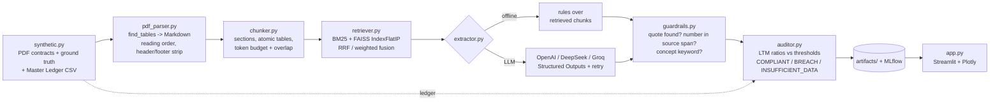

# Financial AI Agent & RAG Auditing Pipeline

An automated AI auditor for loan portfolios. It parses multi-page, unstructured PDF credit
agreements while keeping their table structure, chunks them by document structure, and runs
**hybrid RAG retrieval** (BM25 + FAISS dense search, fused with Reciprocal Rank Fusion). It then
extracts financial covenants and loan terms into **Pydantic-validated Structured Outputs**, and
rejects any value whose evidence cannot be found in the source (**anti-hallucination guardrails**).
Finally it **reconciles** every covenant against a quarterly Master Ledger, producing
COMPLIANT / BREACH / INSUFFICIENT_DATA findings, each with a page and verbatim citation.
Everything runs offline out of the box with a deterministic extractor. OpenAI, DeepSeek or Groq
can be plugged in through one OpenAI-compatible client.

> Context: built for the Halyk AI Challenge. All contracts, companies and banks in this repository
> are synthetic and fictional.

---

## Key results

Real numbers from `python train.py` (quick mode: 24 generated contracts, seed 42, 10 dev / 14 test
contracts, LSA-128 embedder, offline rule-based extractor). All metrics are on the **test split**
unless stated. Runtime: 52 s on an i7-12700H (CPU only).

**Parsing (all 24 contracts):** 159 pages, **45 / 45** ruled tables detected, 636 header/footer
lines stripped, 727 chunks (mean 69.8 tokens).

**Retrieval** (59 queries, one per ground-truth covenant; relevant = chunk containing the clause):

| Retriever | Recall@1 | Recall@3 | MRR |
|---|---:|---:|---:|
| BM25 only | 0.797 | 1.000 | 0.893 |
| Dense only (LSA-128, FAISS IP) | 0.542 | 1.000 | 0.766 |
| Hybrid RRF (k=60, equal weights) | 0.797 | 1.000 | 0.893 |
| BM25 + query expansion | 0.983 | 1.000 | 0.992 |
| Hybrid RRF + query expansion | 0.949 | 1.000 | 0.975 |
| **Tuned on dev: RRF, alpha=0.3, expansion** | **0.983** | **1.000** | **0.992** |

Same quick setup with `--embedder st` (all-MiniLM-L6-v2): MiniLM alone reaches R@1 0.407 (0.763 with
expansion). The dev-tuned hybrid (weighted fusion, alpha=0.3, expansion) reaches **R@1 1.000 / MRR
1.000**, against 0.983 / 0.992 for BM25 + expansion.

**Extraction** (offline rules + guardrails, 59 ground-truth covenants):

| Metric | Value |
|---|---:|
| Field-level precision / recall / F1 (type, operator, threshold, unit, frequency) | 1.000 / 0.864 / 0.927 |
| Numeric exact match | 0.864 |
| Hallucination rate (accepted values not in the contract) | 0.000 |
| Loan terms accuracy (borrower, principal, currency, rate type, rate, maturity) | 1.000 |
| Recall: standard prose / table rows / **hold-out paraphrases** | 1.000 (15) / 1.000 (36) / **0.000 (8)** |

**Guardrail stress test** (synthetic hallucinations fed through the guardrail): numeric perturbation
59/59, near-copy quote with swapped number 59/59, fabricated quote 59/59, wrong covenant type 27/27
rejected. **Hallucination detection 1.000, false rejection of genuine covenants 0.000.**

**Breach detection** (findings from extracted covenants vs. findings from ground-truth covenants):
precision **1.000**, recall **0.882**, F1 0.938 (15 / 17 breaches). Both missed breaches come from
hold-out paraphrases that the rules did not extract. All 17 injected breaches are recovered when the
true covenants are audited (sanity check of the generator and auditor).

**Full mode** (`python train.py --full`: 80 contracts, 32 dev / 48 test, 119 s): 521 pages, 166/166
tables; tuned retriever R@1 0.969 / MRR 0.984 (BM25 alone: 0.714 / 0.846); extraction field
P/R/F1 1.000 / 0.948 / 0.973, hallucination rate 0.000, hold-out recall 0.167 (12); stress test
detection 1.000 with 0 false rejections; breach P/R/F1 1.000 / 0.987 / 0.993 (74 / 75).

> **Read these numbers honestly.** The offline rules and the generator were written by the same
> author, so 1.000 on standard and table phrasings is an upper bound, not a claim about real-world
> contracts. The hold-out paraphrases are the realistic part: the rules miss them (recall 0.0–0.17)
> while the guardrails keep precision at 1.0. Closing that gap is the job of the LLM extractor
> (`--llm openai|deepseek|groq`). **No LLM run is reported here:** no API key was available in the
> build environment. The LLM path, including Structured Outputs and retry-on-validation-error, is
> covered by unit tests with a mocked OpenAI client.

---

## Architecture



---

## Method

**Parsing.** `page.find_tables()` (PyMuPDF / fitz, `use_layout=False` for ruled tables) turns each
table into Markdown, and the table's text lines are removed from the prose flow. Lines in the top and
bottom 7% bands that repeat on at least 50% of pages (digits masked) are stripped. Lines are classified
as left / right / full-width relative to the page centre, and a band containing a right column is read
column by column. Bold short lines become headings. Each element keeps its page number.

**Chunking.** Headings are hard boundaries and tables are atomic. Sentences are merged greedily up to
`max_tokens=160`, and up to 32 tokens of trailing sentences are carried into the next chunk. The
section breadcrumb is prepended to the indexed text. Optional semantic breakpoints cut where the
cosine of consecutive sentences' TF-IDF vectors falls below the 20th percentile.

**Retrieval.** BM25 (Okapi, $k_1=1.5$, $b=0.75$):
$\mathrm{BM25}(q,d)=\sum_{t\in q}\mathrm{IDF}(t)\,\frac{f(t,d)(k_1+1)}{f(t,d)+k_1(1-b+b\,|d|/\mathrm{avgdl})}$.
Dense: L2-normalised embeddings, so $\langle u,v\rangle=\cos(u,v)$, searched with an exact FAISS
`IndexFlatIP`. Fusion uses either Reciprocal Rank Fusion
$\mathrm{RRF}(d)=\sum_i w_i/(k+r_i(d))$ with $k=60$ and $w=[2(1-\alpha),2\alpha]$, or a weighted
fusion of min-max-normalised scores $\alpha\,\hat s_{dense}+(1-\alpha)\,\hat s_{bm25}$. Each covenant
type has a query template. Optional *obligation-context expansion* adds LMA "Financial Condition"
vocabulary so that obligations outrank definitions. Expansion, fusion method and $\alpha$ are
grid-searched on the dev split. Selection is plateau-aware: among ties, the configuration whose
$\pm0.2$ neighbourhood also scores best wins.

**Structured extraction.** The output contract is the Pydantic model `ExtractionPayload` (list of
`Covenant` + `LoanTerms`). Business rules live in validators, not in JSON-schema keywords, so the
schema stays compatible with strict mode: max covenants need `<=`/`<`, ratio thresholds stay under
50x, amounts are in full currency units, and every populated loan term needs its own quote. OpenAI
uses `client.chat.completions.parse(response_format=ExtractionPayload)`; DeepSeek and Groq use JSON
mode with the schema in the prompt; a strict `json_schema` mode is also available. Temperature is 0.
On a `ValidationError` the formatted errors are appended to the conversation and the call is retried
(max 3 attempts).

**Guardrails.** For every value: (1) the evidence quote must occur in the retrieved chunks, either as
an exact normalised substring or as a fuzzy `difflib` window with ratio >= 0.90; (2) the extracted
number must occur in the **matched source span**, among typed number mentions (ratio / currency /
percent), so the "1.00" of "1.25:1.00" cannot ground a fake 1.0; (3) the source span must mention
the covenant concept. Failed values are REJECTED with reasons and excluded from the audit.

**Reconciliation.** Flows are taken on a last-twelve-months basis,
$\mathrm{LTM}_t(x)=\sum_{i=t-3}^{t}x_i$, and stocks are point-in-time:
$\text{Leverage}_t=\text{Debt}_t/\mathrm{LTM}_t(\text{EBITDA})$,
$\text{DSCR}_t=\mathrm{LTM}_t(\text{EBITDA})/\mathrm{LTM}_t(\text{Debt Service})$,
$\text{ICR}_t=\mathrm{LTM}_t(\text{EBITDA})/\mathrm{LTM}_t(\text{Interest})$, current ratio,
financial-year capex (tested at Q4) and tangible net worth. Tests follow the frequency (quarterly,
semi-annual = Q2/Q4, annual = Q4). Equality within $10^{-9}$ complies with `<=`/`>=` and breaches
`<`/`>`. Missing quarters are re-indexed as NaN, so an LTM window never bridges a gap; they produce
INSUFFICIENT_DATA with the missing column and period named. $\text{headroom}=(\theta-x)/\theta$
for ceilings and $(x-\theta)/\theta$ for floors.

**Metrics.** $\mathrm{Recall@k}$ is the share of covenant queries whose clause chunk is in the top-k.
MRR is the mean reciprocal rank of the first relevant chunk. Field-level P/R/F1 is computed over 5
fields per covenant. Numeric exact match counts exact thresholds. Hallucination rate is the share of
accepted covenants whose (type, threshold) pair is not in the contract. Breach P/R/F1 is computed on
(contract, covenant, period) keys, against an audit of the ground-truth covenants.

---

## Repository layout

```
financial-rag-auditor/
  src/
    synthetic.py     contract PDF + ground truth + Master Ledger generator (PyMuPDF)
    pdf_parser.py    tables -> Markdown, reading order, header/footer stripping
    chunker.py       structure-aware chunking (+ optional semantic breakpoints)
    retriever.py     BM25, LSA / MiniLM embedders, FAISS IndexFlatIP, RRF, weighted fusion
    schemas.py       Pydantic v2 models (Covenant, LoanTerms, ExtractionPayload, AuditFinding, ...)
    guardrails.py    quote / number / concept grounding
    providers.py     OpenAI / DeepSeek / Groq config via env vars + base_url, .env loader
    extractor.py     offline rules, StructuredLLMClient (parse | json_schema | json_object + retry)
    auditor.py       LTM metrics, operator semantics, findings with citations
    evaluation.py    retrieval / extraction / stress-test / breach metrics, fusion tuning
    pipeline.py      shared glue (parse -> chunk -> index -> extract -> audit)
    tracking.py      fail-safe MLflow logging (SQLite store in the repo)
    text_utils.py    normalisation, sentence splitting, number/date parsing and formatting
  tests/             115 offline tests + 1 network test (skipped by default)
  train.py           end-to-end CLI
  app.py             Streamlit + Plotly dashboard
  requirements.txt  .env.example  pytest.ini  README.md  TUTORIAL_RU.md
```

Generated at runtime (git-ignored): `data/synthetic/` (PDFs, ground truth JSON,
`master_ledger.csv`), `artifacts/` (`metrics.json`, `audit_report.csv/json`,
`retrieval_comparison.csv`, `fusion_tuning.csv/png`, `breach_heatmap.png`,
`covenants_extracted.csv`, `extraction_results.json`, `guardrail_stress_test.csv`), `mlflow.db`, `mlruns/`.

---

## Quickstart

```bash
python -m venv .venv
.venv\Scripts\activate            # Windows  (Linux/macOS: source .venv/bin/activate)
pip install -r requirements.txt

python train.py                   # quick mode, ~1 min, fully offline
python train.py --full            # 80 contracts, ~2 min
streamlit run app.py              # works even before train.py (in-memory demo corpus)
pytest                            # ~40 s, offline
mlflow ui --backend-store-uri sqlite:///mlflow.db
```

Useful flags: `--embedder st` (sentence-transformers, downloads all-MiniLM-L6-v2 once),
`--semantic-breaks`, `--chunk-tokens 160 --overlap 32`, `--top-k 5`, `--holdout-frac 0.2`,
`--no-mlflow`. Network-marked tests run with `pytest -m network`.

### Using an LLM provider

Copy `.env.example` to `.env` (git-ignored) and set one key:

| Provider | Key | Default model (`*_MODEL`) | Base URL (`*_BASE_URL`) | Mode (`*_RESPONSE_MODE`) |
|---|---|---|---|---|
| OpenAI | `OPENAI_API_KEY` | gpt-4o-mini | SDK default | `parse` (strict Structured Outputs) |
| DeepSeek | `DEEPSEEK_API_KEY` | deepseek-chat | https://api.deepseek.com | `json_object` |
| Groq | `GROQ_API_KEY` | llama-3.3-70b-versatile | https://api.groq.com/openai/v1 | `json_object` |

```bash
python train.py --llm openai      # LLM extractor on the test split, compared with the offline rules
```

The dashboard lists every provider whose key is set. LLM extraction only runs when you press the button.

### Dashboard tabs

**Document** shows the rendered page next to the parsed elements: headings, text, and tables as
DataFrames. **Chunks** shows the size histogram and chunk list. **Retrieval inspector** shows BM25 /
dense / fused scores per hit, flags the ground-truth chunk, and has switches for fusion method,
alpha, top-k and expansion. **Extraction & guardrails** lists covenants and loan terms with
VERIFIED / REJECTED status, match score and reasons, plus the source chunk with the quote
highlighted, the ground-truth comparison, and this contract's audit. **Reconciliation** has KPI
tiles, a borrower x period heatmap of worst status (colour plus text label), breaches per borrower,
an actual-vs-threshold chart with breach markers, a filterable findings table and CSV export.
**Evaluation** shows the metrics of the last training run.

---

## Design decisions & trade-offs

* **Synthetic, fully labelled corpus.** Real credit agreements are confidential, and evaluation needs
  exact labels (threshold, operator, page, quote). The generator varies wording, operators (`<=`
  vs `<`), number formats, prose vs table layout, two-column blocks and distractors: facts stated in
  representations, margin-ratchet grids, baskets, equity-cure amounts and repayment schedules. A
  20% hold-out of unseen paraphrases keeps the evaluation of the rules honest.
* **Per-document index.** An audit reads one agreement at a time, and mixing documents risks
  attributing a threshold to the wrong borrower. With 20–60 chunks per document an exact
  `IndexFlatIP` is the right tool; HNSW/IVF only pays off at ~10^5 vectors.
* **LSA as the default dense model.** It gives zero cold start, needs no network, and fits in about 1 s.
  The experiments show its limitation openly: LSA is built from the same lexical statistics as BM25,
  so the hybrid only matches BM25 + expansion. A neural embedder (MiniLM) is what makes the hybrid
  better than either side.
* **Query expansion beats fusion here.** Inside a single contract, *all 12* rank-1 misses of BM25 on
  the test split are the "1.1 Definitions" chunk outranking the obligation clause. Adding
  obligation-context vocabulary fixed most of them (R@1 0.797 -> 0.983).
* **Validators instead of schema keywords.** They work with every provider's strict or JSON mode,
  and the error text drives the retry loop.
* **Ground numbers in the source, not in the quote.** This is the only check that catches a
  near-copy quote with a swapped number.
* **Rejected values stay visible.** An auditor must see what the system could *not* verify.
* **Breach labels from the same auditor applied to the true covenants.** The breach metric then
  isolates the cost of extraction errors. The auditor itself is unit-tested on hand-computed cases,
  and every injected breach must be recovered (sanity check).
* **MLflow cannot break the run.** Any tracking error disables tracking, and `artifacts/` is still written.

## Limitations

* No OCR: scanned PDFs, and tables drawn without ruling lines, need OCR / `strategy="text"` / a layout model.
* Single-threshold covenants only. Step-downs, equity-cure adjustments and contract-specific EBITDA
  add-backs are not modelled in the auditor.
* The offline rules are brittle on unseen wording by design (hold-out recall 0.0–0.17). No LLM
  results are reported because no API key was available while building the project.
* The synthetic contracts are much shorter (6–8 pages) and cleaner than real syndicated facility
  agreements (100+ pages, cross-references, amendments).
* Borrower names are matched to the ledger with legal-form stripping and fuzzy matching. In
  production this should use a stable identifier (BIN / LEI).

## References

* S. Robertson, H. Zaragoza. *The Probabilistic Relevance Framework: BM25 and Beyond*, 2009.
* G. Cormack, C. Clarke, S. Buettcher. *Reciprocal Rank Fusion outperforms Condorcet and individual Rank Learning Methods*, SIGIR 2009.
* S. Deerwester et al. *Indexing by Latent Semantic Analysis*, JASIS 1990.
* N. Reimers, I. Gurevych. *Sentence-BERT*, EMNLP 2019; model `sentence-transformers/all-MiniLM-L6-v2`.
* J. Johnson, M. Douze, H. Jegou. *Billion-scale similarity search with GPUs* (FAISS), 2019.
* N. Liu et al. *Lost in the Middle: How Language Models Use Long Contexts*, TACL 2024.
* Loan Market Association (LMA) facility agreement conventions: "Financial Condition" clause, LTM Relevant Periods.
* Documentation: PyMuPDF `Page.find_tables`, OpenAI Structured Outputs, Pydantic v2, rank-bm25, MLflow, Streamlit.
